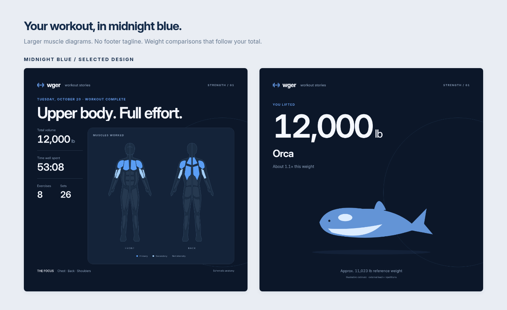

# Workout images: review milestone

Included in v0.2.0 as experimental rendering/browser tools, **not integrated into production sync**. See the [main README](../README.md#experimental-workout-image-tools) for the published `-media` image and downloadable Compose setup. The checkout-based commands below remain useful for development.

Selected direction: **Midnight blue**, with the bottom tagline removed and front/back muscle diagrams enlarged from 370 px to 510 px tall. The light variant remains available for reference.

- Light: wger navy/blue, white anatomy panel, restrained statistics.
- Dark: deep navy, brighter muscle highlights, a stronger feed contrast.



Individual previews: [light summary](previews/light-summary.png), [light comparison](previews/light-comparison.png), [dark summary](previews/dark-summary.png), [dark comparison](previews/dark-comparison.png).

The sample 12,000 lb total is synthetic design data; it selects an orca at approximately 1.1× its reference weight. The anatomy is original schematic vector artwork: primary/secondary colors identify muscle metadata, not activation intensity. No Hevy artwork is bundled.

## Weight comparisons

All 30 supplied examples are included, from a 1,600 kg hippopotamus through the 6 billion kg Great Pyramid of Giza. See the [illustrated catalog](previews/comparison-catalog.png) and [reference data](../src/wger_strava/media/comparisons.py).

Reference masses are the approximate kilogram figures supplied for this design. Displayed pounds are calculated from kg rather than storing a second, independently rounded weight. These examples describe illustrative animals, vehicles and structures, not verified specifications for particular specimens or models.

The renderer selects the closest mass using the unrounded workout volume in kg; an exact tie selects the lighter reference. It shows a fraction or multiple of that reference, including totals below the smallest example and above the largest. Very small fractions display as a percentage. Zero recorded external load has no object equivalence. Changing display units preserves the selected subject. Every reference has an original local SVG illustration; rendering makes no remote image requests.

Inter Variable v4.1 is bundled from the [official Inter repository](https://github.com/rsms/inter/tree/v4.1), with its SIL Open Font License in `src/wger_strava/media/assets/INTER-LICENSE.txt`. All anatomy and comparison SVG paths are original project assets under this repository's MIT license.

## Render the concepts

```sh
docker compose -f compose.media.yaml build
docker compose -f compose.media.yaml run --rm preview
```

Four 1080×1080 PNGs, the selected dark pair in `concepts.png`, and a 30-subject `comparison-catalog.png` are written to `design/previews/`. Templates and fonts are entirely local; the renderer blocks network requests. The Debian/Python base is pinned by digest. Playwright 1.63.0 installs only its matching Chromium build, used for both interactive and headless operation.

## Login on a headless Docker host

```sh
docker compose -f compose.media.yaml run --rm --service-ports media-login
```

Open `http://localhost:6080/vnc.html`. Enter the temporary viewer password printed by the command, then sign into Strava **inside that browser**. You handle password entry, MFA and any login challenge. No Strava password goes in `.env`. Stop the service with Ctrl+C when done; the Chromium profile remains in its named volume.

Some Strava login cookies last only for a browser session. The viewer saves those cookies on graceful shutdown in a private, atomically replaced `session-cookies.json` file (mode 0600) inside the locked profile directory, and restores them on the next launch. Browser workers must use the same save/restore helpers. This preserves a valid login; it does not extend a session that Strava has expired or revoked.

For a remote server, first open an SSH tunnel from your laptop:

```sh
ssh -N -L 6080:127.0.0.1:6080 user@your-server
```

Open the same localhost viewer URL on your laptop. The remote server needs no desktop, display or GPU. Only this temporary login service publishes a port, bound to loopback. A future worker will reuse the volume headlessly. An exclusive profile lock prevents login and automation from opening the same profile concurrently. Browser state is private authentication material; never commit, share, or place it in a release asset.

## Test the browser proof

```sh
docker compose -f compose.media.test.yaml up -d --wait mock-strava-web
docker compose -f compose.media.test.yaml run --rm test
docker compose -f compose.media.test.yaml down
```

This uses real Chromium with a mock website. It exercises file selection, saving two PNGs, reopening the activity, persistent login across browser restart, wrong-account rejection, duplicate prevention, and uncertain-save recovery. It does not use Strava credentials or forward requests to Strava. The mock DOM is a behavioral fixture; it is **not evidence that the live Strava selectors work**.

`attach_mock` explicitly rejects live Strava URLs. An operator-run [live browser feasibility test](LIVE-VALIDATION.md) has now saved both sample cards to a nominated private activity and verified their persistence after a browser restart. This does not connect the prototype to production workout exports.

## Approval gates and next work

The dark direction has been selected, the requested visual revisions are included, and live browser feasibility has been established for one consenting account. Next add the durable outbox, wger muscle metadata snapshots, automatic attachment to confirmed export IDs, robust media identity verification, recovery/status commands, both architecture builds and GHCR release integration. Keep current API exports independent of browser/media failures.
