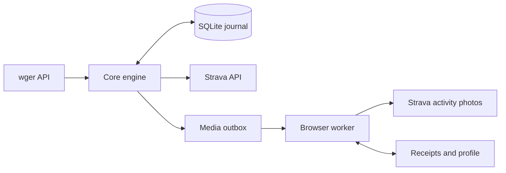

# Architecture

## Overview

The core watcher reads wger and writes Strava. A separate browser worker consumes immutable image jobs after confirmed exports.



## Components

### CLI and configuration

`cli.py` handles authorization, maintenance and watcher dispatch. `config.py` validates URLs, ranges, dates and timezone names.

### API and conversion

`api.py` handles HTTP, OAuth rotation, origin validation and persisted rate-limit cooldowns. `workout.py` converts actual logs into the structured strength payload, rejecting unsupported units and incomplete mappings.

### Engine and journal

`engine.py` computes fingerprints, binds accounts, polls uploads and records write intent before each POST. `state.py` locks the volume and commits SQLite updates with full synchronization. The `settings` table holds identity, OAuth, mappings and boundary; `exports` holds per-session upload state and attempt history.

### Media

`media/queue.py` snapshots exact exported sets and source muscle metadata. `media/worker.py` renders two cards with Chromium, verifies destination identity and journals intent before browser mutations. It shares files with the core but does not open SQLite. Browser failures do not stop API exports.

## Data flow

`preview` filters completed sessions past the configured UTC boundary and settling cutoff. It reads session-linked logs and marks the entire workout blocked when any set cannot be represented. `sync` first polls processing jobs, then submits eligible plans. A confirmed activity ID allows a media job. Each job keeps its source snapshot, so later source edits do not rewrite existing images.

## Directory layout

```text
src/wger_strava/       CLI, API, engine, state and conversion
src/wger_strava/media/ Queue, renderer, muscle mapping and worker
tests/                Unit, release, integration and browser fixtures
examples/             Released Compose overlays and media setup
design/               Historical art reviews and validation
scripts/              Release version and asset generation
```

Trace a run with `docker compose run --rm connector preview`, then compare `status` after `sync` as described in [usage](usage.md).
